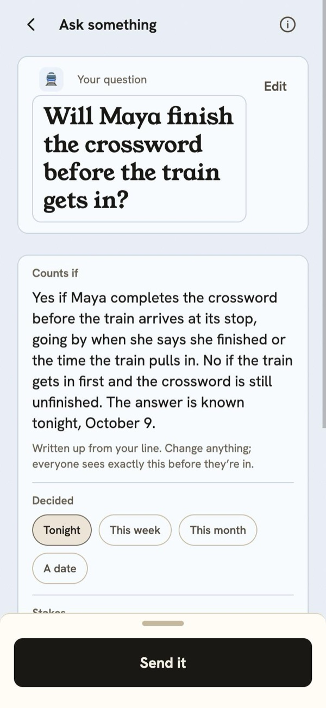
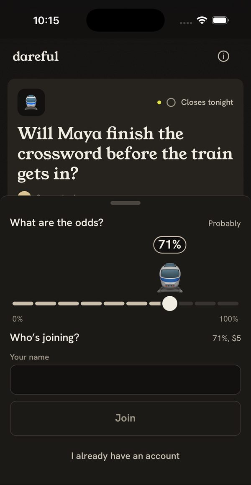
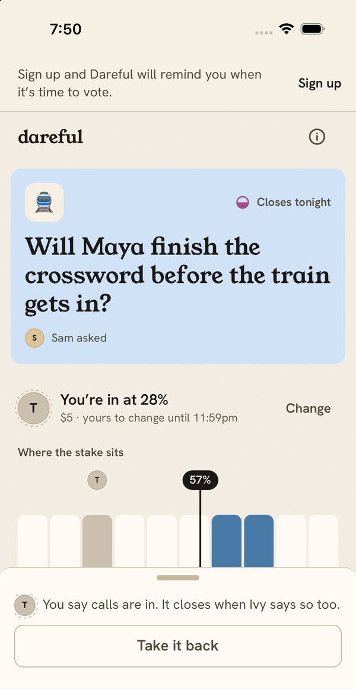
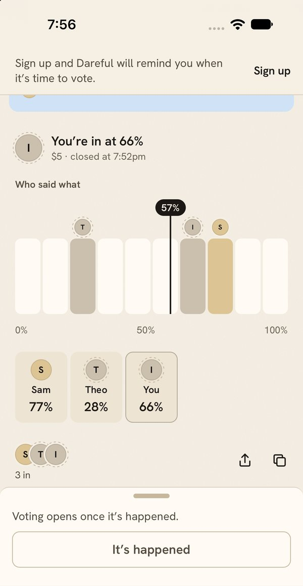
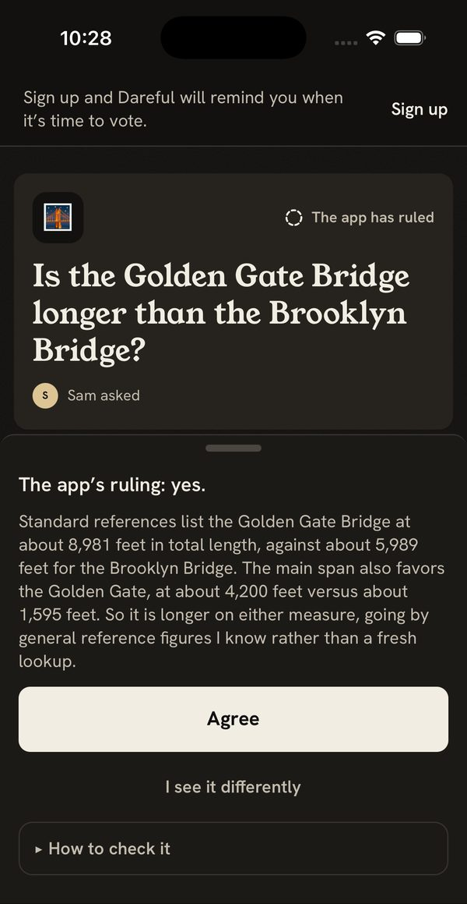
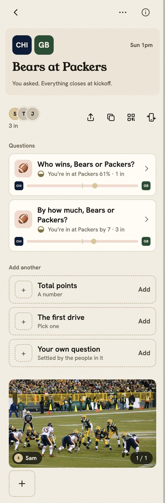
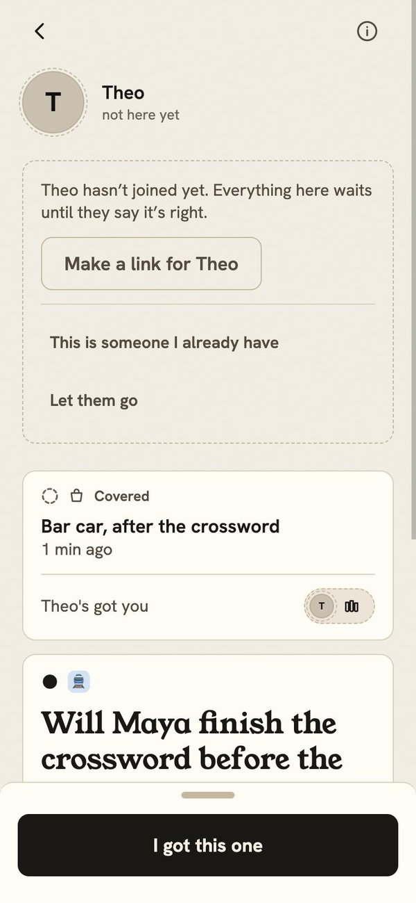
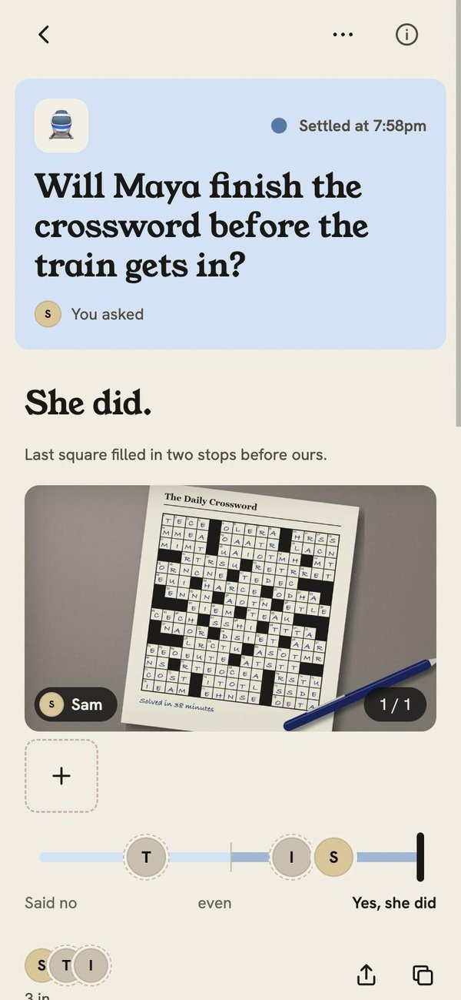
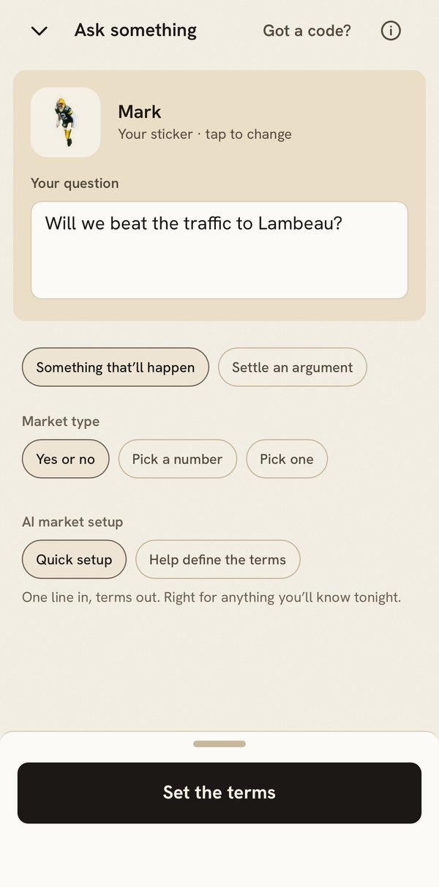

# Dareful

Dareful is a social prediction app for friend groups: someone asks the group a question, everyone puts a number and a stake on it, and the people in it decide what happened. Each person is scored on how close they came, and what that leaves between friends is kept as a record on Monad, signed by the people it binds, that nobody can move or sell.

Two things draw people in. The first is questions only your friends can answer, like "can John run a faster 40-yard dash than the slowest guy at the NFL combine?" or "will Chris finish the entire pizza?", which no sportsbook or prediction market will ever list. The second is live events made social: on a sportsbook every bet is against the house, and on Dareful the same game is a bet between friends, for a few dollars or a beer, whether they're watching together or from different cities. The stakes are the group's own (dollars, beers, rounds, or a unit the group makes up), every question keeps a record of the event in its photos and stickers, and for now friends settle up however they already do while Dareful keeps the record ([Path forward](#path-forward) says why).

Live at [dareful.app](https://dareful.app) · [The demo](https://youtu.be/hXyMfEGSLRw) · [The pitch](https://youtu.be/LCKwCI77st0) · [Try it yourself](#try-it-yourself)

## Where each criterion is answered

| Criterion | Read |
| --- | --- |
| Founder and market readiness | [Who it's for](#who-its-for), [Who's building it](#whos-building-it) |
| Traction and path forward | [Traction](#traction), [Path forward](#path-forward), [How it grows](#how-it-grows) |
| Technical execution | [Why the chain isn't decoration](#why-the-chain-isnt-decoration), [Check it yourself](#check-it-yourself), [How it works](#how-it-works), [Quality](#quality) |
| Design and craft | [What it looks like](#what-it-looks-like), [Design and craft](#design-and-craft) |
| Originality and track insight | [Why the chain isn't decoration](#why-the-chain-isnt-decoration), [Sponsors](#sponsors), [The AI](#the-ai) |

## Who it's for

Dareful is for a friend group of four to eight people who share a group chat and see each other every couple weeks. I'm in several groups like that, and they already bet: beers on the game, a round on whether someone finishes the pizza, five dollars on an argument at dinner. Today those bets live in the group chat and in people's memories. Sportsbooks and prediction markets price events anyone can look up, and neither has a place for a bet about things your friends bet on, like whether Chris finishes the pizza or whether John falls asleep during the movie.

Groups like mine use the app because Dareful asks for nothing they don't already do. A question is a link dropped into the chat they already have, anyone joins with just a name, it works the same on Android, and the app helps maintain a ledger of who owes what to whom. Every bet starts with a decision the group was already making, and the record is what that decision leaves behind.

What real groups changed in their first weeks on dareful.app:

- September 24. A friend told me the first design looked like it could have been any app's. Its one accent color, a marigold, came out, and every question now gets its own ink when it's asked: from its mark (the emoji, sticker or picture its asker picked), otherwise from the question itself, kept apart from the other questions open between the same people. A question's own screen is drawn in its ink, and everywhere else the ink sits behind its mark, so a list of questions reads as one app and each question still feels like its own place.
- September 26. Friends wanted to bet on bigger things than the questions they made up, like the game they were watching, and still only with each other. What's on now lists the games ahead and the ones being played: anyone can start questions on a game until its final (who wins, by how much, the total), and the final score proposes the answer.

<details>
<summary>Four things that broke for real groups in October, and how each was fixed</summary>

- October 2. Questions on a game never closed. The scoreboard's day was read in UTC, so an evening game in the East was looked up under the next day's date and its final never came, and the scheduler's queue kept skipping questions that couldn't close, so one with five people in it never reached the front. The day is now the scoreboard's own, the queue leaves out what can't close, and a game's questions close at kickoff.
- October 2. People didn't come back to vote. Of the first fourteen questions to reach voting, four sent anyone a request to vote, and those reached nobody: most people had never allowed notifications. Everyone in a question now hears when voting opens, and anyone still out gets one reminder twelve hours in.
- October 4. Joining from a link asked for more than a name: a phone number, and a check against it when someone picked a name already there. Now a name is all it takes: the call is saved first, and keeping it in an account is offered after, with Google, email or a phone.
- October 4. A question about something months away came back with no terms, because the write-up stopped at four months. It now names the date it's decided by, up to three years out, and says so plainly when a question can't be known that soon.

</details>

## Who's building it

I'm Justin Wender, and Dareful is a team of one: I designed it, wrote the brief and the specifications it's built from, tested it with my own friend groups, and directed Claude Code through every phase.
- I studied Politics, Philosophy and Economics at Northeastern (summa cum laude), with a concentration in logic and game theory, and I'm finishing a master's in Economics and Data Science there. Dareful runs on a proper scoring rule, the piece of mechanism design that makes an honest number everyone's best move.
- I was president of NEU Blockchain, Northeastern's blockchain club. I won the BNB Hack: US College Edition with Credence, an onchain credit scoring algorithm (AUC 0.82 on 115,687 Venus Protocol borrowers), first place at Bentley FinTech Day with research on Uniswap's fee switch, and won the Visualization and Insights track at Optimum Hacknet.
- In my spare time, I built a horse racing handicapper that prices races with gradient-boosted models and calibrates their probabilities, the same test Dareful puts to every call: say a number, and see how often you're right at it.
- After a short stint at Allium, a blockchain data company, I now work in research and operations at Fireblocks Financial Services, a subsidiary of Fireblocks. Dareful is my own project, built on my own time, and isn't affiliated with or endorsed by either.

## Traction


The picture above is drawn by the app as it runs, at [dareful.app/numbers](https://dareful.app/numbers), so it keeps counting through judging. It reads the database and the indexer at most once every five minutes and says when it last did.

It leads with questions played: questions someone besides the asker got into. At 12:21pm Eastern on October 13, 18 questions had been played since launch: 13 settled, 5 still open and none ended without a decision. 17 people had made accounts and 8 more had joined as guests, 3 groups had come back for a second question, and 5 people had come in through a friend's question and gone on to ask their own. On Monad, real use had made 22 records, 18 questions, 12 people and 17 sets.

<details>
<summary>How each number is counted, and why most of the chain's transactions are tests</summary>

The numbers are the owner's stats page's own, with every test account left out (an account made with one of Dynamic's test sign-ins, as in [Try it yourself](#try-it-yourself), from the moment it's made), counted since launch (midnight Eastern, September 13, 2026):

- People with accounts: accounts made since launch.
- Guests: people who joined a question with a name and no account, on a question a counted person asked. A guest who later made an account counts as that account.
- Questions played: questions a counted person asked that someone besides the asker got into. Settled is those that ended in a decision, by the vote of the people in, the tiebreaker, the final score or the app's ruling standing, "nobody can tell" included. Still open is those not yet ended, open or closed and waiting on the call. Ended without a decision is those that expired: nobody called them in time.
- Groups that came back: sets of people that asked a second question. A game's questions count once, and a question called off doesn't count.
- Came through a friend's question, then asked: accounts whose first question came after they were already in a question someone else asked.
- Questions asked, on the stats page and the facts sheet: questions counted people sent, leaving out any called off before anyone else got in.
- On Monad, from real use: the records with a counted person on either side, the questions on the chain with a counted person in them, the counted people registered on the chain, and the sets they're registered in.

The test suites run against the live testnet contracts, so most of the contracts' transactions are tests. On October 13, 2026, real use was 2.3% of the transactions that had gone through (77 of 3,284), read from the indexer's events and whose wallets they name ([`scripts/ops/chain-tests.ts`](scripts/ops/chain-tests.ts)). Every chain number in this README counts real use only. A question with a guest in it is decided and settled off the chain, so it isn't in the chain's counts.

</details>

On October 8 a friend asked a question and shared it once, in a group chat of his in Mexico City full of people I’ve never met. Sixteen different devices opened it, fourteen in the first 45 minutes, and two people joined as guests. In the chat, the friend the question was about started bargaining over its terms, and another wrote “Nmms, qué bien jala” (“no way, it works so well”). This test showed me there's still a lot of room for improvement on the friction of joining markets - it seems like there's still too much friction to get people to join a market, and potentially not enough friction for joining as a guest to persuade people into creating an account when joining their first market.

## Path Forward

Today, Dareful settles the small bets friends already make: whether Chris finishes the pizza, who wins Red Sox at Yankees, whether a major league pitch is harder to hit than a Premier League penalty kick is to save. Calls from people with accounts are signed, and when everyone in a question has an account, it's settled on Monad. Whatever anyone owes goes into a ledger the group can trust without anyone holding the money.

The ledger is the part I want to grow. Friend groups already keep one in their heads: who covered dinner, who owes a round, whose turn it is to pay. Next, Dareful adds the games groups already play around that ledger, starting with credit card roulette. Then, I'll add more social ledger features such as splitting a receipt by what each person ordered, and later shared questions for big events (besides sports, which are already in the app), where everyone still plays only against their own friends. These features will make the "You" page much more robust than it is in the current iteration of Dareful.

I've ruled out two things in this version: one for now and one permanently. For now, no money moves through Dareful: what anyone owes is a record, and people pay each other however they already do. Moving money on friends' bets would make Dareful a gambling operator and a money transmitter, and both need licenses. The app would work better if it could settle in dollars itself, and my goal is to settle in real funds on Monad once Dareful holds those licenses, on the same signatures, votes and records it keeps now. Permanently, Dareful will not take a cut of anyone's bet. A cut would turn the app from a bystander into the house, paid more the more everyone bets. That's how a sportsbook makes its money, and Dareful is a social app.

Revenue can come from two places that take nothing out of anyone's bet. One is sponsored live events, where a brand puts its name on the questions around a big event (e.g. the Miller Lite ads when you log into ESPN Fantasy). The other, once Dareful holds a proper money transmission license like Venmo's, is the float: the yield on money waiting between payments, which could sit in a vault on Monad.

Most apps on a phone are built to hold your attention, which pulls you out of the room. I want Dareful to be the app that engages a room of people and brings them closer together: an argument, dare, or friendly wager on a football game, where everyone gets involved on Dareful and the app keeps record of the event afterward.

## How it grows

Growth is built into how a question travels. Every question goes out as a link into a group chat, anyone in that chat joins with a name, and what a guest is owed waits until they make an account to collect it, so every group that plays brings its whole chat in.

Next I'm seeding groups where the bets already happen: my fantasy football league, NEU Blockchain and its alumni, and watch parties through the NFL season and the MLB playoffs, which my 'What’s on' page already lists. Additionally, I'll try to push the app out through family, other friends, and secondary channels (friends of friends, other blockchain clubs, etc.). The numbers I'm watching are groups that ask a second question, guests who make an account to collect what they're owed, and groups that come back the next week.

## What it looks like

<table>
  <tr>
    <td width="25%"></td>
    <td width="25%"></td>
    <td width="25%"></td>
    <td width="25%"></td>
  </tr>
  <tr>
    <td>Asking: one line in, the terms written for it.</td>
    <td>Joining from a link: a number and a name.</td>
    <td>Calls are in: it closes when enough of the people in say so.</td>
    <td>The reveal: every call, and whose it is, once it's closed.</td>
  </tr>
  <tr>
    <td></td>
    <td></td>
    <td></td>
    <td></td>
  </tr>
  <tr>
    <td>An argument no search settles: the app's ruling, sealed when it was asked, shown at the close with Agree.</td>
    <td>A game page: who wins and by how much, before kickoff.</td>
    <td>A friend who joined as a guest: a round covered, and the question you were both in as its story.</td>
    <td>Settled: she did, with a photo of the finished grid.</td>
  </tr>
</table>

The screenshots are from the iOS 26 and iOS 27 simulators and a development browser, in light appearance, on walk data with made-up names. The crossword was drawn for this README. The game page's photo is ["Packers - Bears Game"](https://www.flickr.com/photos/briangiesen/6575070991/) by Brian Giesen, licensed under [CC BY 2.0](https://creativecommons.org/licenses/by/2.0/), from a 2011 game at Lambeau Field; the sticker below was cut from it in the app, a change to the original.

### A sticker from a photo

<table>
  <tr>
    <td width="25%"></td>
    <td width="25%"></td>
    <td width="25%"></td>
    <td width="25%"></td>
  </tr>
  <tr>
    <td>A question's photo, full screen: Make a sticker.</td>
    <td>The cut, pinched in: the Packers' number 12, tapped and outlined.</td>
    <td>Kept, in your stickers: Ask something with it.</td>
    <td>The next question wears it, in the colour the app measured from it.</td>
  </tr>
</table>

A photo on one question becomes the mark on the next: the cut is made on the phone by Google's MediaPipe interactive segmenter, and the server adds the cream edge and measures the sticker's colour from its own pixels ([`src/lib/ui/cut-subject.ts`](src/lib/ui/cut-subject.ts), [`src/lib/media/sticker.ts`](src/lib/media/sticker.ts)).

## Try it yourself

You'll play both people in one question, so you need two accounts. Sign-in runs on Dynamic's sandbox for the hackathon, so you can make test accounts without an inbox: make up two addresses with `+dynamic_test` right before the @, such as `yourname1+dynamic_test@example.com` and `yourname2+dynamic_test@example.com` (pick a name nobody else would, since anyone with the code can open an address), and sign in to each with the code `769426`. Your own Google account or email works for either one too. A question settles on Monad only when everyone in it has an account; a question with a guest in it settles inside the app instead.

This path assumes you want a binary market and quick setup (as opposed to AI helping define the question), but these are customizable market settings.

1. On a phone or a desktop browser, open [dareful.app](https://dareful.app) and tap “Get started”. Type your first address under “Email”, tap “Continue”, enter the code, tap “Continue”, and tell it what your friends call you.
2. Tap “Ask something” and type a question, for example “Will Chris finish the whole pizza?”. Keep “Yes or no” and “Quick setup”, tap “Set the terms”, read the terms the app wrote, pick when it's decided and the stakes, and tap “Send it”. For a faster start, pick a question from Ideas or What’s on instead. 
3. Tap the copy-link icon at the end of the row of who's in, and open the link in a private window, which keeps the two sign-ins apart. Slide to a prediction, tap “I'm in at”, then “I already have an account” (a new address works there too), and sign in with your second address the same way. Your call goes in as that second person.
4. Back in the first window, make your own call: slide to a different prediction and tap “I'm in at”.
5. Close it: as the asker, tap “Close it with 2”, then “Close it now”.
6. See who said what: once it's closed, every call shows under “Who said what”, with whose it is.
7. Settle it: tap “It's happened”, pick what happened, tap “Say it: …”, and confirm in the sheet. Do the same from the other account. When the two agree, it's settled: closest first, and who's got who.
8. See it on the chain: open the questions contract, [DarefulDares](https://testnet.monadscan.com/address/0xd621c7770B96d2bF94638a28A15B3636cC0a3Fa0), on Monadscan. Among its newest transactions are two of yours, both sent by the app's relayer: Create, which put your question on the chain with both signed calls when you closed it, and Resolve, which settled it with both votes. The record of what one of you owes the other is minted on [DarefulLedger](https://testnet.monadscan.com/address/0x8E200d344fA233d85b78f85aC78c3F778397F26D) inside the settlement.

To join as a guest instead, open the question's link in a private window, slide to a prediction, tap “I'm in at”, type a name, and tap “Join as”. A name is all it takes. A question with a guest in it is decided and settled off the chain, and what it leaves waits until the guest makes an account and confirms it.

<details>
<summary>Optional: see a notice arrive</summary>

To see a notice arrive, which is optional: sign in to the first account with your own email or Google in step 1, since a test address is never emailed. A notice goes out when the other person does something, by push where notifications are on and by email from hello@dareful.app, each notice on every channel that takes it. When your second account gets in, the first hears “Sam is in” (with the second account's name and the question); when the second taps “It's happened” once you've closed it, that it says the question has happened; and when the second calls it before you do, that it called it. Closing the question sends nothing by itself, since the vote waits until it has happened. For push too, make the first account's call before the second gets in: once you're in on a question, the app asks once per account, “Want a heads-up?”, and “Turn on notifications” raises the browser's own prompt. On an iPhone it asks only in the app added to the home screen (Share, then Add to Home Screen, then open it from there and sign in), since Safari on an iPhone can't take a push; on Android or a desktop browser, the browser itself is enough. Your address is read from your sign-in when a notice is sent, and never stored.

</details>

## Design and craft

Dareful is built around how a friend group already socializes, with nothing to unlock and nothing to install. A question is a link dropped into the group chat the friends already have, anyone joins with a name on any phone, a friend without their phone makes their call on yours with their own PIN, and nobody sees a wallet, a token or a fee. Calls stay anonymous until the close, and then the reveal shows who said what, each call in its owner's colour. Every question is drawn in its own ink, taken from the emoji, sticker or picture its asker picked, and keeps a record of the event in its photos and stickers.

<details>
<summary>The five principles it was specified against, and where each shows</summary>

Five of the principles the product was specified against ([`PLANNING.md`](PLANNING.md), section 2), and where each shows:

- Notify about what people did, never about states of the world. Most notices name a person and what they did ("JP closed …", "Rae is in on …"), and Now never counts, badges or says how long anything has waited; its one citron dot means only that something has a clock. The rest mark a clock everyone in agreed to when they entered: the close time ("Time's up on yours" to the asker), the vote opening at the close time or a game's final ("Time's up on Sam's …", "The final is in on Sam's …"), and a warning before, and a notice after, the final score or the tiebreaker settles a question the people in didn't. One more, a reminder to vote twelve hours in, was ruled in by name for real groups that never came back to vote.
- The creditor authors, the debtor confirms. "I got this one" is logged from the friend's page by whoever paid, never "Gabe owes me", and nothing reaches the ledger until the other person taps yep on Now.
- Count before amount. What's between two people reads as tallies and words ("Theo's got you" with a round's glyph) before any dollar figure, and an amount shows its cents only when it isn't whole dollars.
- Forgiveness is a status move. "Call it even" sits beside "Settled" as an equal choice on every record its creditor holds, and it closes the record on the chain the same way.
- One account per bet, not one per person. Joining a friend's question takes a name and nothing else; the account comes later, and only to collect what the guest is owed.

</details>

The design itself is specified in [`docs/design.md`](docs/design.md): every token as a literal value, a dark and a light appearance from one set of tokens, nine type tokens and a lint that holds every screen to four sizes, and the motion, layers and sheets drawn for a phone held in one hand.

## Why the chain isn't decoration

In Dareful, what a group creates stays with the group. The argument a group was already having, or the game it was already watching, becomes calls each person signs; the people in a question decide what happened by their own votes; and each record of what someone won is held in the wallet of the friend it's owed to, where nobody else, the app included, can move or change it (only that friend can close it, by marking it settled or calling it even). Dareful takes no cut, and neither of its planned revenues touches a bet: sponsored live events, paid by brands, and, once Dareful holds a money transmission license, the yield on money waiting between payments, which could sit in a vault on Monad. The stakes are real (dollars, beers, rounds), and friends settle them however they already do.

A friend group's ledger only works if nobody, the app included, can quietly change it. The chain carries exactly the parts two people have to agree on, and the app can't forge any of them:

- A call from someone with an account is signed by their everyday wallet over the exact prediction and stake they sent, and every signed call lands together in the one transaction that puts the question on the chain, so nobody can change a number after the close, and nobody can say they called something they didn't.
- A vote is signed by the voter's voting wallet, which the server never holds, so the server can write the ledger but can never decide a question. The contract reads the voters from the voting wallets of exactly the people in, and counts a majority of them.
- When facts can settle an argument, the app rules on it when it's asked and seals the ruling: the seal goes into the terms everyone signs, and so into the terms' hash that goes on the chain with the question, before anyone has called. The app can't change its ruling after seeing who's on which side.
- What a question leaves is a record (an ERC-1155 token) that can't be transferred, sold or redeemed; the contract refuses every transfer. There's no market for it and the app holds no money, so it stays a record between friends, who settle up however they already do.

Everything one person controls stays off the chain: the question's words, the photos, the names. A question with a guest in it waits off the chain too, since nobody signed for the guest, and what it leaves goes on the chain only as each person makes an account and confirms.

These are the rails real settlement will run on: once Dareful holds the licenses to move money, the same signatures, votes and records can settle in real funds on Monad.

## Check it yourself

Recompute the question from [the demo](https://youtu.be/hXyMfEGSLRw) from the chain. On October 12, three people called a yes-or-no question, one at 90% with $20 on it and two with $10 each, at 10% and 35%, and it didn't happen. [The transaction that put it on the chain](https://testnet.monadscan.com/tx/0x39c3479b5379916fe2e58bde70ff956edf4ac1a8afdf30db372bd1677689c86b) (Create, on Monadscan) carries the three signed calls (`Entered` events: stakes 2000, 1000 and 1000 cents, values 9000, 1000 and 3500 in basis points), and [its settlement](https://testnet.monadscan.com/tx/0xf3d85015fb4f6cf1612ceac4f3d8a938420b28c5461574aa2cd44fe51d897e23) (Resolve) carries two votes for no, a majority of the three, then a `Scored` event for each person and the three records it minted:

- Each score is the Brier rule in basis points, here for an answer of no: 10000 − 9000² / 10000 = 1900, 10000 − 1000² / 10000 = 9900, and 10000 − 3500² / 10000 = 8775.
- Each pair settles on the difference: the smaller stake × (the higher score − the lower) / (people in − 1) / 10000, truncated toward zero. The 90% caller owes the 10% caller 1000 × 8000 / 2 / 10000 = 400 cents, and the 35% caller 1000 × 6875 / 2 / 10000 = 343.75, truncated to 343; the 35% caller owes the 10% caller 1000 × 1125 / 2 / 10000 = 56.25, truncated to 56. Those are the three records minted in the settlement: $4, $3.43 and $0.56. The 90% caller pays $7.43 in all; nobody ever pays more than their stake.

The contract's scoring functions are public, so the same numbers come from the deployed contract itself (Foundry's `cast`, on Monad's public RPC):

```bash
cast call 0xd621c7770B96d2bF94638a28A15B3636cC0a3Fa0 "scoreBinary(uint256,uint256)(uint16)" 9000 0 --rpc-url https://testnet-rpc.monad.xyz
```

```bash
cast call 0xd621c7770B96d2bF94638a28A15B3636cC0a3Fa0 "pairwiseTransfer(uint256,uint256,uint16,uint16,uint256)(int256)" 2000 1000 1900 8775 3 --rpc-url https://testnet-rpc.monad.xyz
```

The first answers 1900, the 90% caller's score; the second answers -343, the 90% caller paying the 35% caller.

Check a sealed ruling. When an argument closes, "How to check it" under the app's ruling shows the seal from the terms everyone signed, the salt and the ruling's text. Save the text to `text.txt` and, from a clone of this repository after `npm install`:

```bash
node -e 'const fs=require("fs"),{keccak256,concat,stringToHex}=require("viem");console.log(keccak256(concat([process.argv[1],stringToHex(fs.readFileSync("text.txt","utf8").replace(/\n+$/,""))])))' 0xTHE_SALT
```

It prints the seal: keccak-256 of the salt's 32 bytes followed by the text, whose first line is the verdict and the rest the reasons ([`src/lib/ledger/seal.ts`](src/lib/ledger/seal.ts)).

Check every question at once. [`scripts/verify-envio.ts`](scripts/verify-envio.ts) recomputes every question on the chain from its entries and outcome with the contract's rule, compares each payment with the chain and with what the indexer recorded, and checks the indexer's open records between every pair of the seed's people against the contract's own balances. Run against the indexer's October 10 deployment, it found no mismatch across 966 edges and 660 questions (63 number questions, 79 pick-one) with their 937 minted payments. It reads the app's database and the chain, so it runs with the app's environment (`npm run verify:envio`); the scoring check above needs only Foundry's `cast`, and the seal check a clone of this repository.

The contracts' source is verified on Sourcify, a full match for both: [DarefulDares](https://repo.sourcify.dev/10143/0xd621c7770B96d2bF94638a28A15B3636cC0a3Fa0) and [DarefulLedger](https://repo.sourcify.dev/10143/0x8E200d344fA233d85b78f85aC78c3F778397F26D), built with solc 0.8.28 from [`contracts/`](contracts), and on Monadscan since October 13, so each transaction there shows the function it called.

Every explorer link in this README goes to Monadscan, which shows each one. On October 12, MonadVision answered NODE_REQUEST_ERROR, with nothing loaded, for transactions the chain has: their receipts, read from Monad's public RPC, say success.

## How it works

Next.js 16 (App Router, React 19) on Vercel at dareful.app; Postgres on Supabase through Drizzle; two Solidity contracts on Monad testnet (Foundry, OpenZeppelin 5's ERC-1155); Envio HyperIndex, which reads every event the contracts emit; Dynamic for sign-in and two embedded wallets per person; Anthropic's models for writing terms and weighing outcomes; Web Push and email (Resend) for notifications; and one scheduler, a once-a-minute call to `/api/tick`.

The rule that splits the two halves: anything two people must agree on goes on the chain, and anything one person controls stays off it. Nobody holds a key that can move value, and the records can't be transferred, sold or redeemed; the contract refuses every transfer.

Every person has two wallets: an everyday wallet, which signs what binds only its owner (their call, confirming a record against themselves, closing what they're owed), and a voting wallet, which signs only votes, always asks, and is never delegated. The code calls them `ledgerWallet` and `governanceWallet`. Every action a person takes on the chain is a message signed by their own wallet, which one relayer submits and pays for; the relayer's own calls are registering a set's people and units, recording a ruling (the tiebreaker's, the final score's, or the app's own standing) and an expiry.

The app reads the chain's history only through the indexer, never scanning a log. Some values come straight from the contracts over the RPC, where a signature or a send depends on them: a record's close counter and a pair's netting nonce, a question's voters, whether a set, a person or a unit is registered yet, the relayer's own nonce, receipts and balance, and the health checks. A settlement is first recorded from its own transaction's receipt, with the indexer as the fallback.

<details>
<summary>What goes on the chain, function by function</summary>

What goes on the chain, and why:

- Signed calls. A call is an EIP-712 message signed by its owner's everyday wallet over exactly the numbers they sent. At the close, one transaction puts the question on the chain (`create`) with its terms' hash and every signed call, and they land together or not at all.
- Each question's own voters. The contract reads the quorum from the voting wallets of exactly the people in: the question goes in its set's group when that group is exactly them, and otherwise in a group of its own registered at the close. Nobody outside a question can vote on it.
- Settlement. A vote is a signature from the voter's voting wallet, which the server never holds, so the server can write the ledger but can never cast a vote; the settlement (`resolve`) checks a majority of the people in. When they don't decide, the relayer records the tiebreaker's ruling, the final score or the app's ruling standing, with the ruling's hash (`arbitrate`), and an expiry ends a question nobody called, minting nothing (`expire`).
- Records. Each person is scored (Brier for yes or no, the miss over the scale for a number, all or nothing for pick one), and the lower scorer pays the higher, pair by pair, never more than their stake. Each payment is a non-transferable ERC-1155 record, minted inside the settlement with a 16-byte id its Postgres row shares. A cover ("I got this one") is minted when the person who owes it confirms it (`confirm`); settling and calling it even (`close`) and cancelling out (`net`) burn them.
- The sealed ruling. When an argument is asked and facts can settle it, the app rules at once and seals the ruling: the seal is keccak-256 of a random 32-byte salt followed by the ruling's text, and it ends the terms everyone signs. The terms' hash goes on the chain with the question, so the ruling is fixed before anyone calls.

</details>

| Contract (Monad testnet, chain 10143) | Address |
| --- | --- |
| DarefulLedger: the records, sets, members and units | [0x8E200d344fA233d85b78f85aC78c3F778397F26D](https://testnet.monadscan.com/address/0x8E200d344fA233d85b78f85aC78c3F778397F26D) |
| DarefulDares: questions, calls, votes, scores | [0xd621c7770B96d2bF94638a28A15B3636cC0a3Fa0](https://testnet.monadscan.com/address/0xd621c7770B96d2bF94638a28A15B3636cC0a3Fa0) |
| The relayer, which pays gas and holds nothing else | [0x4534C3f805F1cc483C0b0193F754C16E0d2cdaA7](https://testnet.monadscan.com/address/0x4534C3f805F1cc483C0b0193F754C16E0d2cdaA7) |

<details>
<summary>One transaction from real use for each kind of event</summary>

One transaction from real use for each kind of event (from [`scripts/ops/real-use-txs.ts`](scripts/ops/real-use-txs.ts); a test's transaction never stands in for one):

| Event | Monadscan's method | Real use |
| --- | --- | --- |
| A question put on the chain with its signed calls (`DareCreated`, `Entered`) | Create | [October 9](https://testnet.monadscan.com/tx/0x36e7c05906882392a30a35b220d7598d6c763b00d13fcf1dae918a17d889dc2a) |
| A set registered with its people (`GroupCreated`) | Create Group | [October 9](https://testnet.monadscan.com/tx/0x16d5a6ada77e2062bc3781ef48535c053f74cb0d86adce34bc928f779c6b195a) |
| A person added to an existing set (`MemberAdded`) | Add Member | [October 11](https://testnet.monadscan.com/tx/0x35b874000acb5316e817ab3ba39dae7e8063a804bea047921ea22891e5b70e49) |
| A unit registered (`DenomCreated`) | Create Denom | [October 9](https://testnet.monadscan.com/tx/0xe755e4c77bf380dcaa0dcdee1e92998ad71f84cadfd394506fbfaebc32c4bf0c) |
| Settled by the vote of the people in, with each score and the record it minted (`DareResolved`, `Scored`, `Confirmed`) | Resolve | [September 26](https://testnet.monadscan.com/tx/0x903db4d37f4876cb8491410069ceaeface2b48081ba385dac12fbd02add180f5) |
| Settled by the final score, recorded by the relayer, with each score and the records it minted (`DareArbitrated`, `Scored`, `Confirmed`) | Arbitrate | [September 28](https://testnet.monadscan.com/tx/0x0f1add16cc1a5510ca9bb3f9a9ebe75b86301c6e8d540627bc0000b2b7c41ef4) |
| An argument settled by the app's ruling standing, recorded by the relayer with its text's hash (`DareArbitrated`, `Scored`, `Confirmed`) | Arbitrate | [October 9](https://testnet.monadscan.com/tx/0xe00814e6ed2bf6e5e2387a41c277edbab724972df531ddeb3b8cf3dd89be0830) |
| Voided by the tiebreaker (`DareArbitrated`) | Arbitrate | [October 4](https://testnet.monadscan.com/tx/0x2623889754eb5a792042e6dc78d3520d57df2ea9a382b2b6f9bdf69e41f89cb3) |
| A record confirmed by the person who owes it (`Confirmed`) | Confirm | [October 8](https://testnet.monadscan.com/tx/0xe04a5e06afcb3b3a2d716d6f647b9f7722e8b3c788b337444aadb9a833a154f2) |

Real use has none yet of a void by vote, an expiry, settling or calling it even, cancelling out, or a sealed ruling (the three arguments real use has on the chain were asked before rulings were sealed, on October 8). The names in parentheses are the contracts' events, which the indexer stores.

</details>

## Sponsors

### Dynamic

Dynamic signs people in and gives each of them two embedded wallets on Monad without a word about wallets, and its delegated access is what lets a friend make their call on someone else's phone. Sign-in is the app's own sheet on Dynamic's headless hooks (Google through `useSocialAccounts`, email or phone through `useConnectWithOtp`); Dynamic's modal never opens, its signing sheet is off, and Monad testnet is registered in code. At a first sign-in the app makes both wallets with `createWalletAccount`, and the server verifies Dynamic's JWT against the environment's JWKS and fixes the pair from the token's own credentials: the everyday wallet and the voting wallet. Pass the phone delegates the everyday wallet alone (`delegateKeyShares`): Dynamic's webhook delivers its share, which the app checks by an HMAC over the raw body, unwraps with its RSA-OAEP key and seals under its own AES-256-GCM key, and the server signs with `@dynamic-labs-wallet/node-evm` only inside a request its owner authenticated (their PIN on a friend's phone, or their own session on a second device), recovering every signature to the everyday wallet. The voting wallet is never delegated: the webhook refuses it before decrypting anything, a database trigger refuses to store it, the signer refuses it by address, and Dynamic is asked to deny it the moment an account is made; a gate against Dynamic's sandbox on September 27 showed Dynamic refusing it too. All 17 people who have made accounts have both wallets. See [`src/components/auth/`](src/components/auth), [`src/lib/dynamic/networks.ts`](src/lib/dynamic/networks.ts), [`src/lib/auth/login.ts`](src/lib/auth/login.ts), [`src/lib/chain/delegated-signer.ts`](src/lib/chain/delegated-signer.ts), [`src/app/api/delegation/route.ts`](src/app/api/delegation/route.ts), [`src/lib/ledger/pass-the-phone.ts`](src/lib/ledger/pass-the-phone.ts) and [`src/lib/ledger/hand-over.ts`](src/lib/ledger/hand-over.ts).

### Envio

HyperIndex reads every event both contracts emit, 13 kinds, into current state (each record with what remains open on it, the sets, people, units, questions and calls) plus one entity per event, and the app reads the chain's history only through it. Whether a record is still open, and whether it was settled or called even, isn't kept in Postgres: People draws every friend's line from one `OpenTouching` query, a friend's page reads `OpenBetween` and `ByIds`, and Now's "Just happened" reads the indexer's counters. The handlers attribute every netting to a pair's records oldest first in both directions, so a close is signed over the smaller of the indexer's remainder and the chain's counter, and they link each record a question minted to the question through the settlement's transaction hash; when the app's own write after a settlement fails, `reconcileFromIndexer` records it from the indexer. It syncs through HyperSync with no RPC in its config and runs on Envio Cloud, where production reads the deployment made on October 10; the health check counts it as a core system, down once it's a minute behind the chain. Against that deployment, [`scripts/verify-envio.ts`](scripts/verify-envio.ts) found no mismatch across 966 edges and 660 questions with their 937 minted payments. See [`indexer/`](indexer) (its config, schema, handlers and seven handler tests) and [`src/lib/ledger/envio.ts`](src/lib/ledger/envio.ts), where every query is checked with Zod.

### Alchemy

Alchemy's Monad testnet RPC carries every transaction Dareful sends. Every action a person takes on the chain is an EIP-712 message signed by their own wallet, which one relayer submits through Alchemy and pays for, beside the relayer's own calls. It simulates each call first, since a revert on Monad still pays its declared gas; under one advisory lock that every server instance shares, it reads the nonce, signs locally, records the write in Postgres and only then broadcasts, and the scheduler finishes, sends again or reports any write with no receipt in twenty seconds. Every function has an explicit gas limit measured on Monad, since Monad charges the declared limit and Foundry's figures were wrong for it (netting measured 78k in Foundry and 128k on Monad). The free tier allows `eth_getLogs` over ten blocks at a time, so the app never scans logs. The relayer's transport weighs every call at Alchemy's published compute-unit cost: 21,650 calls for 489,802 units from October 9 to October 13, against the free plan's 30 million a month, with the owner warned at 70 and 90 percent. The key is server-only (the browser and Dynamic's SDK read Monad's public RPC) and is cut out of every error the app logs, stores or shows. See [`src/lib/chain/relayer.ts`](src/lib/chain/relayer.ts), [`src/lib/chain/gas.ts`](src/lib/chain/gas.ts), [`src/lib/ops/rpc-usage.ts`](src/lib/ops/rpc-usage.ts) and [`src/lib/redact.ts`](src/lib/redact.ts).

## The AI

- Haiku 5.5 drafts: it writes a question's terms from one line (its type, the date it's decided by, the outcomes in the question's own words, a mark if none was picked), and asks the questions under Help define the terms.
- Sonnet 5.5 weighs: it decides whether facts can settle an argument (and declines a matter of taste or one between two people, offering to make it a dare), rules on it at the ask, proposes an outcome from what people said happened, writes Help define's final terms, and answers again for any draft that fails its shape or runs out of time.
- Opus 5.5 is the tiebreaker: it rules only when the people in a question don't decide it and they agreed to a tiebreaker when they entered, and it voids unless what's in front of it clearly supports one outcome.

Every call is in [`src/lib/ai/`](src/lib/ai) behind a typed function, its answer checked with Zod, with a plain fallback, so a model is never on the critical path: it proposes, the asker approves the terms, and the people in decide. A draft that fails is asked once of Sonnet and counted. No test or audit process can call the live API. Besides what people ask for, and the tiebreaker when the people in a question stall, the app calls a model on a schedule twice: the health check's one-token ping, about once an hour while the API answers and on every check while it doesn't, and the canary's write-up every six hours. Every answer's tokens and searches are now kept, priced at the published rates, so the app knows what it has spent.

<details>
<summary>What a question costs</summary>

What a question costs, measured on October 9 by replaying every question counted people have written (26) on the models in use, at list prices ([`scripts/dev/compare-models.ts --part=current`](scripts/dev/compare-models.ts)): $0.0004 for a question's terms on average ($0.0005 at most), and $0.017 for an argument (the terms, the check at $0.005 and the sealed ruling at $0.011). The tiebreaker, when it runs, cost $0.010 to $0.013 a ruling on Opus 5.5 (every past ruling replayed on October 6). An outcome proposal measured about $0.004 on Sonnet 5.5 on October 4. Help define the terms with a web search adds 2 to 11 cents (measured October 8).

</details>

## Quality

[](https://github.com/justinwender/dareful/actions/workflows/watch.yml)

A GitHub workflow outside the app fetches the health check, the home page and the numbers picture, and fails when any of them doesn't answer, a core system is down, or the health answer isn't production's own. It's scheduled every fifteen minutes, which GitHub runs far less often: from October 10 to 13 it ran 21 times on the schedule, from 24 minutes to 7.7 hours apart, and once after each of the 9 production deploys, and all 30 runs passed. Its six-hourly sign-in pass waits for the test account's two secrets and hasn't run yet.

- Production watches itself. [`/api/health`](https://dareful.app/api/health) answers every system as ok, slow or down: the database, the scheduler, the chain's node, both contracts, the relayer's gas and the indexer decide it, and the model API, email, sign-in, storage, both scoreboards, push and the two images the app draws are reported beside them. Every six hours a canary runs one real question through every system as two accounts that count for nothing, on the chain and back through the indexer, and removes it. It passed by hand on October 9, then failed at its first step on all twelve scheduled runs from October 10 to 13, because its setting in Vercel had been pasted with quotes around it, which changed the keys it derives; each failure reached the owner by email, and with the setting fixed it passed again on October 13 at 12:38pm Eastern, in 7.6 seconds. Every resource the app could run out of has a warning line and an urgent one, and the owner gets an email and a push the moment one is crossed or a core system has been down for ten minutes, and a summary every morning.
- The suites run against the real database and the live testnet contracts: 566 unit tests, 260 database tests and 131 tests against the running server (one of them only against a deployed app), 957 in all, every one passing on October 12. The sports tests share their tables with production's own scheduler, which acts on every game once a minute, so every final they see is ahead of the real clock and their own reads, warnings and backstop run on a clock ahead of it; their file passed five runs in a row. Their rows are made for a run and removed after it, and their accounts are left out of every count.
- Every test has a mutant, but the one that runs only against a deployed app: a change to the code that breaks the rule the test names, which the test has to catch. The full audit runs each one alone against the live database and contract.
- Every round was walked by hand and recorded with what broke and what changed in [`docs/testing.md`](docs/testing.md), 49 sessions in all: on the owner's phones and in signed-in development browsers, and from the QA round on also on the iOS 26 and iOS 27 simulators, in Safari, private tabs and installed copies. The checks that need a real phone are listed and numbered there.

<details>
<summary>Every mutation audit, and what the last full one found</summary>

| Audit | Date | Mutants | Result |
| --- | --- | --- | --- |
| Scoped, pre-submission bug fixes 3 | October 12 | 17: 1 unit, 16 database | All killed |
| Scoped, pre-submission bug fixes 2 | October 12 | 149: 59 unit, 81 database, 9 http | All killed: 95 before the batch shipped for the demo, and the 54 left after |
| Scoped, pre-submission bug fixes 1 | October 10 and 11 | 580: 230 unit, 336 database, 14 http | All killed; two first ended in the runner's timeout instead of failing, their tests bounded, both killed |
| Scoped, the ops round | October 10 | 146: 86 unit, 47 database, 13 http | 145 killed; one survived, the http copy of an edit the database test kills, which the local server can't show until this build's scheduler is running |
| Full, the submission round | October 9 | 1,682: 997 unit, 427 database, 258 http | 1,679 killed on the run. Three survived and twelve kills could not be vouched for, because their tests also failed on the unbroken code (below); with those tests fixed, all fifteen are killed |
| Scoped, the final round | October 9 | 398: 182 unit, 207 database, 9 http | 395 killed; three survived, their tests strengthened, all killed |
| Scoped, the touch-ups round | October 8 | 432: 164 unit, 262 database, 6 http | 430 killed; two survived, their tests strengthened, both killed |
| Scoped, games and the reveal | October 7 | 400: 138 unit, 229 database, 33 http | 399 killed; one survived, its test fixed, killed |
| Full, first contact's second pass | October 6 | 1,480 | 1,477 killed in the run and three run alone after the development server crashed six hours in, all killed |

The full audit ran one mutant at a time against the live contract and the production database, with its chain calls on Monad's public RPC and the local indexer so production kept its own RPC key and its indexer's queries, and spent 8.10 MON in four hours. Its closing run of every suite on the unbroken code found eight tests failing for reasons outside the product: the runner's one-process mode had left the live-API guard off (the runner now turns live calls off by name, held by a test of its own), the public RPC answers fifteen requests a second and the chain-scoring tests read faster than that (they now pace their reads), and two tests were written before this round's changes (updated). Nothing the audit did moved a number on the stats page, and every account it made is left out of every count.

</details>

## Limits

- It runs on Monad testnet, and the contracts have had no outside security review.
- A question with a guest in it is decided and settled off the chain; what it leaves goes on the chain only as each person makes an account and confirms.
- The test suites share the live contracts and the production database, so most of the contracts' transactions are tests (above), and the counts leave every test account out.
- Sign-in runs on Dynamic's sandbox environment, and delegated signing for pass the phone is a sandbox feature; production use needs Dynamic's Enterprise plan. The sandbox holds 1,000 users, after which nobody new can sign in until test accounts are deleted; the app reads how many it holds (49 on October 13) and warns its owner at 700.
- Pass the phone lets a friend without their phone make a call on yours with their own PIN, and the PIN lets the app use only the wallet that signs their own calls, so their vote still comes from their own phone. Saying calls are in from the host's phone is for after the hackathon.
- The relayer alone registers people in sets. A compromised relayer could register someone who isn't real into an existing set; membership changes signed by the voting wallet are needed before mainnet. Whether Dynamic keeps each wallet's key material cryptographically apart is not proven; the server never receives the voting wallet's share.
- There's no native app: it's a web app you can add to the home screen, and on an iPhone, notifications arrive only in the added app.
- The indexer runs on Envio Cloud's free plan, which answers 100 queries a minute and keeps a deployment for 30 days. Production reads the one made on October 10, which lasts to about November 9, and the app reads how many days it has left and warns its owner a week ahead.

The depth: [`PLANNING.md`](PLANNING.md) is the architecture, [`docs/design.md`](docs/design.md) the design, [`docs/decisions.md`](docs/decisions.md) every decision with the alternative rejected, and [`docs/testing.md`](docs/testing.md) every round of testing. [`CLAUDE.md`](CLAUDE.md) is the working brief, and the code was written with Claude Code working from it, one approved phase at a time. MIT licensed.
